GEOMETOR • poincare
===================

**Visit the Online Archive:** https://geometor.github.io/poincare/

**Henri Poincaré • La Science et l'Hypothèse (Science and Hypothesis) • semantic digital archive**

Mission
-------

``geometor/poincare`` is part of the interconnected `GEOMETOR <https://geometor.com>`_ semantic digital archive. Henri Poincaré's epistemological masterwork revolutionized geometry through non-Euclidean spaces, continuous transformation groups, and the conformal hyperbolic disk model. Within this archive, Poincaré's philosophical and mathematical treatises are liberated from isolated print bounds into addressable semantic units, synchronized 4-track bilingual codices, calibrated theme-adaptive vector diagrams, and exact symbolic formulations in SymPy and Rational Trigonometry across the GEOMETOR corpus.

Books in This Archive
---------------------

- `Science and Hypothesis <https://geometor.github.io/poincare/science_and_hypothesis/>`_ — La Science et l'Hypothèse (1902 / English 1905), featuring unabridged bilingual French-English codex tracks across number, magnitude, space, and hypotheses, paired with calibrated interactive SVG diagrams.

Repository Contents
-------------------

- ``docsrc/`` — Sphinx documentation source, 4-track bilingual Book Codex tracks, translation dictionary, and apparatus compiled by `PHOTON publish <https://github.com/photon-platform/publish>`_.
- ``resources/`` — Archival source manifests, prosopography, and bilingual philosophical glossary registries.
- ``src/geometor/poincare/`` — Exact symbolic hyperbolic disk engine, invariant validators, and figure generators.

Local Build & Verification
--------------------------

.. code-block:: bash

   publish build
   uv run --no-sync pytest

Part of the GEOMETOR Knowledge Archive
--------------------------------------

Explore all **74 Book Codices** and **11 Mathematical Catalogs** at https://geometor.com/books/.
