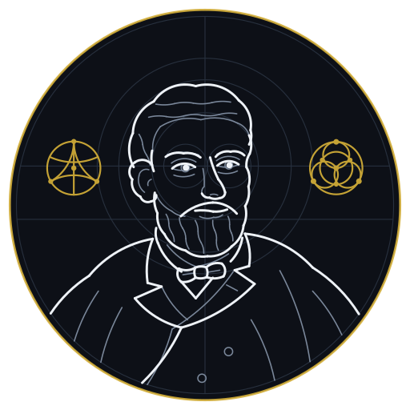

:site_title: Henri Poincaré

.. container:: author-overline

   semantic digital archive • the works of

==============
Henri Poincaré
==============

:person:`Henri Poincaré <poincare>` (1854–1912) reshaped the philosophy of geometry at the turn of the twentieth century by showing that geometric axioms are neither *a priori* necessities nor empirical facts, but free *conventions* guided by experience—and by translating Lobachevskian non-Euclidean space directly into Euclidean circles orthogonal to a unit disk. This synchronized four-track French–English edition pairs the 1902 Flammarion text of *La Science et l'Hypothèse* with the 1905 English translations, interactive conformal disk diagrams, and exact symbolic proofs.

Books in This Collection
------------------------

.. container:: home-book-hero

   .. container:: home-book-thumb

      .. image:: _static/figures/fig2_poincare_dictionary_inversion.svg
         :alt: Poincaré's Translation Dictionary and Horizon Circle Inversion
         :target: science_and_hypothesis/index.html

   .. container:: home-book-body

      .. rubric:: Primary Edition · 1902 / 1905 · Parts I & II (Chs. I–V) · 4 Tracks

      **Science and Hypothesis (La Science et l'Hypothèse)** — Poincaré's foundational treatise on mathematical induction (*raisonnement par récurrence*), the physical versus mathematical continuum, the Non-Euclidean Translation Dictionary, the heated-disk model, continuous transformation groups, and geometric conventionalism across **8 calibrated vector figures**.

      .. container:: home-actions

         * :doc:`Open Science and Hypothesis → <science_and_hypothesis/index>`
         * :doc:`Part I: Number & Magnitude → <science_and_hypothesis/part_01/index>`
         * :doc:`Ch. III: Non-Euclidean Geometries → <science_and_hypothesis/part_02/ch_03/index>`
         * :doc:`Ch. IV: Space & Geometry → <science_and_hypothesis/part_02/ch_04/index>`

Key Features
------------

.. container:: home-feature-grid

   .. container:: home-feature-card

      **Synchronized 1902 French & 1905 English**

      Every chapter aligns the 1902 Ernest Flammarion French text (including *Les Géométries de Hilbert*) with W. J. Greenstreet's 1905 translation, structural summaries, and mathematical notes.

   .. container:: home-feature-card

      **Exact Conformal Disk & Rational Hyperbolic Proofs**

      The :doc:`Symbolic Demos <demos/index>` implement exact horizon inversion and orthogonal geodesic circles in ``geometor.poincare.disk`` over :math:`\mathbb{Q}` and quadratic extensions with zero floating-point approximations.

   .. container:: home-feature-card

      **Translation Dictionary & Cross-Corpus Concordance**

      Explore Poincaré's Euclidean–Lobachevskian dictionary and **12 cross-corpus loci** linking Euclid, Hilbert, Russell, Hoenen, Klein, Pappus, and Wildberger in the :doc:`Concordance <science_and_hypothesis/concordance>`.

Reference & Project
-------------------

.. container:: home-columns

   .. container:: home-col

      .. rubric:: Scholarly Apparatus

      * :doc:`Translation Dictionary & Concordance <science_and_hypothesis/concordance>` — Lobachevskian–Euclidean dictionary and cross-corpus matrix
      * :doc:`People <science_and_hypothesis/people/index>` & :doc:`Bibliography <science_and_hypothesis/bibliography>` — 28 biographical profiles and primary/secondary editions
      * :doc:`Glossary <science_and_hypothesis/glossary>` — French, German, Latin, and English terminology

   .. container:: home-col

      .. rubric:: About This Project

      * :doc:`About <about/index>` — Scope, textual witnesses, and Poincaré's place in GEOMETOR
      * :doc:`Using This Edition <usage/index>` & :doc:`Symbolic Demos <demos/index>` — Navigation guide and SymPy hyperbolic disk models
      * :doc:`Log <log/index>`, :doc:`Changelog <changelog>`, & :doc:`Modules <modules/index>` — Development notes, release history, and Python API

.. toctree::
   :hidden:
   :maxdepth: 2

   science_and_hypothesis/index
   demos/index
   about/index
   usage/index
   log/index
   changelog
   modules/index
